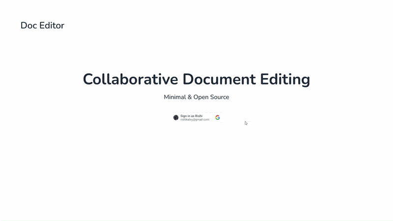

# DocEditor

A real-time collaborative document editor. Multiple users can edit the same document simultaneously with changes synced live via WebSockets.



## Stack

| Layer         | Technology                |
|---------------|---------------------------|
| Frontend      | SvelteKit (Node adapter)  |
| Backend       | FastAPI                   |
| Database      | PostgreSQL                |
| Reverse proxy | Nginx                     |
| Auth          | Google Sign-In            |
| Containers    | Docker + Docker Compose   |

## Architecture

```
Browser
   │
   ▼
Nginx :8000
   ├── /api/*  ──────► FastAPI :8000
   │                       │
   │                       ▼
   │                   PostgreSQL :5432
   │
   └── /*      ──────► SvelteKit :3000
```

WebSocket connections (`/api/edit-socket/*`) are routed to FastAPI and kept alive for real-time collaboration.

## Prerequisites

- Docker Desktop
- Make
- Node.js 20+ (for local dev without Docker)
- Python 3.12+ (for local dev without Docker)

## Environment Variables

Copy each `*.env.example` to the matching `.env` file and fill it in. The `.env` files are git-ignored and excluded from Docker build contexts.

### `frontend/.env`

```bash
PUBLIC_GOOGLE_CLIENT_ID=        # Google OAuth client ID
INTERNAL_JWT_SECRET=            # Secret for internal SvelteKit, used to encrypt cookies data
SHARED_JWT_SECRET=              # Secret shared between frontend and backend
```

These are **build-time** values. The frontend imports them from `$env/static/*`, so Vite inlines them into the bundle during `npm run build`. The Makefile passes this file to compose with `--env-file`, compose fills the frontend build args from it, and the Dockerfile exposes them to the build as `ARG`s. Consequences:

- After changing a value, rebuild the frontend image; restarting isn't enough.
- Always build through `make` (or pass the same `--env-file` flags yourself). A plain `docker compose build` builds the frontend with empty secrets.
- The secrets are present in the built image under `/app/build`.

### `backend/.env`

```bash
POSTGRES_HOST=                  # "postgres" when running via Docker Compose, "localhost" when running the backend outside Docker
POSTGRES_PORT=5432
POSTGRES_USER=
POSTGRES_PASSWORD=
POSTGRES_DB=
SHARED_JWT_SECRET=              # Must match frontend
```

Runtime only: injected into the container by `env_file:` and read with `os.environ`.

### `postgres/postgres.env`

```bash
POSTGRES_USER=                  # Must match backend/.env
POSTGRES_PASSWORD=              # Must match backend/.env
POSTGRES_DB=                    # Must match backend/.env
```

Injected into the container by `env_file:`. The Makefile also passes it with `--env-file` so the healthcheck's `${POSTGRES_USER}` / `${POSTGRES_DB}` in `docker-compose.yml` resolve. They're only used to create the database on first boot (empty `pgdata` volume); changing them later has no effect unless you wipe the volume (`make clean`).

## Running Locally

### With Docker (recommended)

```bash
# Build images
make build

# Start all services
make up

# Or build and start with file watching
make dev
```

In `make dev`, backend changes under `backend/app` are synced into the container and the backend restarts. Frontend changes trigger a rebuild of the frontend image, because the container runs the compiled build.

App is available at `http://localhost:8000`.

### Without Docker (tested with an older commit)

**Frontend**

```bash
cd frontend
npm install
npm run dev
```

Runs at `http://localhost:5173`. Vite proxies `/api` requests to the backend.

**Backend**

Requires Postgres to be reachable. Easiest way is to keep just the database in Docker and run the backend directly:

```bash
docker compose up postgres
```

Then, with `POSTGRES_HOST=localhost` set in `backend/.env` (Postgres' container port is published to the host):

```bash
cd backend
uv pip install -r requirements.txt
uvicorn app.main:app --reload --port 8000
```

## Makefile Reference

| Command           | Description                                           |
|-------------------|-------------------------------------------------------|
| `make build`      | Build all Docker images                               |
| `make up`         | Start all containers in the foreground                |
| `make up-build`   | `make build` then `make up`                           |
| `make dev`        | Build and start with file watching                    |
| `make rebuild`    | Force rebuild from scratch and start                  |
| `make down`       | Stop all containers                                   |
| `make logs`       | Tail logs from all services                           |
| `make ps`         | Show running containers                               |
| `make clean`      | Stop containers, remove volumes and dangling images   |


## Deployment

### Environment

Set real values in `frontend/.env`, `backend/.env` and `postgres/postgres.env` before building. Frontend values are baked in at build time, so don't push the frontend image to a public registry.

For production with HTTPS terminating upstream (load balancer, Cloudflare etc.), add to the Nginx `frontend` location block:

```nginx
proxy_set_header X-Forwarded-Proto https;
proxy_set_header X-Forwarded-Host $http_host;
```

### Build and deploy

```bash
make rebuild
```

### Updating a single service

```bash
docker compose --env-file frontend/.env --env-file postgres/postgres.env build frontend
docker compose --env-file frontend/.env --env-file postgres/postgres.env up -d --no-deps frontend
```

The `--env-file` flags are required for the frontend build; without them its secrets are built in empty.

`--no-deps` restarts only the target service without touching others.


## Learning points about Docker

- `--env-file` on the `docker compose` command line only sets compose's interpolation context. It fills `${VAR}` inside docker-compose.yml and build `args:` listed without a value. It doesn't put anything into containers.
  - Without it, compose falls back to a `.env` file next to docker-compose.yml (none here), so `args:` end up empty.
- A service's `env_file:` / `environment:` are runtime only. They're injected into the running container, never into the image build.
  - `environment:` lists each var inline; `env_file:` loads them from a file.
- `args:` under `build:` are passed to the Dockerfile's `ARG`s.
  - During the build, ARGs are exposed as environment variables to `RUN` commands and their child processes (e.g. `npm run build` → `vite build`).
  - They aren't kept in the final image's environment; use `ENV` for that.
- SvelteKit's `$env/static/*` imports are inlined at build time, so they need build args. `$env/dynamic/*` are read at runtime from the container environment, so `env_file:` works for those.
- `.dockerignore` excluding `.env*` means a `.env` file is never available inside the build.

- init.sql in `/docker-entrypoint-initdb.d/` isn't a build step. The Postgres entrypoint runs it at container startup, only when the data volume is empty (first boot).
  - It runs with the container's runtime env vars, from `env_file:`.
- AI response for the Postgres build and boot process
```
Right — for Postgres there's no build step involved at all in the first place, since your compose file uses image: postgres:18.6-alpine3.24 (a pre-built image pulled from Docker Hub), not build:. There's no Dockerfile being compiled for this service, so "build time" isn't even part of this picture the way it is for your frontend/backend.

What actually happens is entirely at container startup:

docker compose up starts a container from that image.
The image's entrypoint script (docker-entrypoint.sh, baked into the postgres image itself) runs first, before Postgres itself starts.
That script checks whether /var/lib/postgresql/data (your pgdata volume) is empty.
If empty (first-ever boot, or a wiped volume): it reads POSTGRES_USER, POSTGRES_PASSWORD, POSTGRES_DB from the container's environment (however they got there — environment:, env_file:, doesn't matter, both are runtime injection either way) and runs initdb to create a brand-new database cluster with that user/password/database.
If not empty (volume already has data from a previous run): the entrypoint script skips initdb entirely and just starts Postgres against the existing data. At this point, POSTGRES_USER/PASSWORD/DB are read but ignored for bootstrapping purposes — the role and database already exist from whenever they were first created, with whatever password was set back then.
```