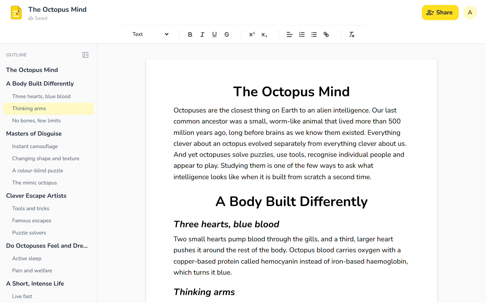
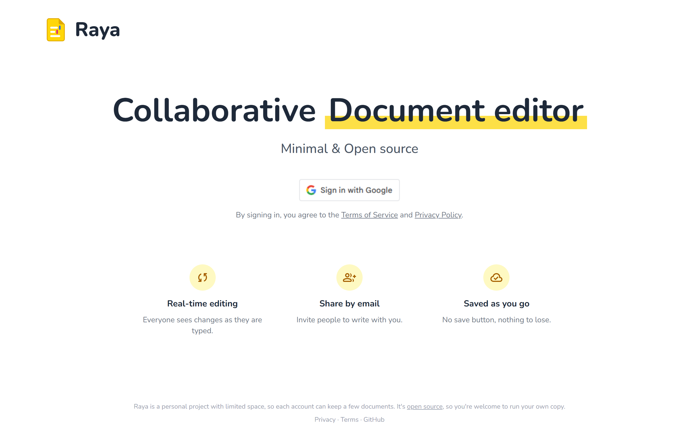
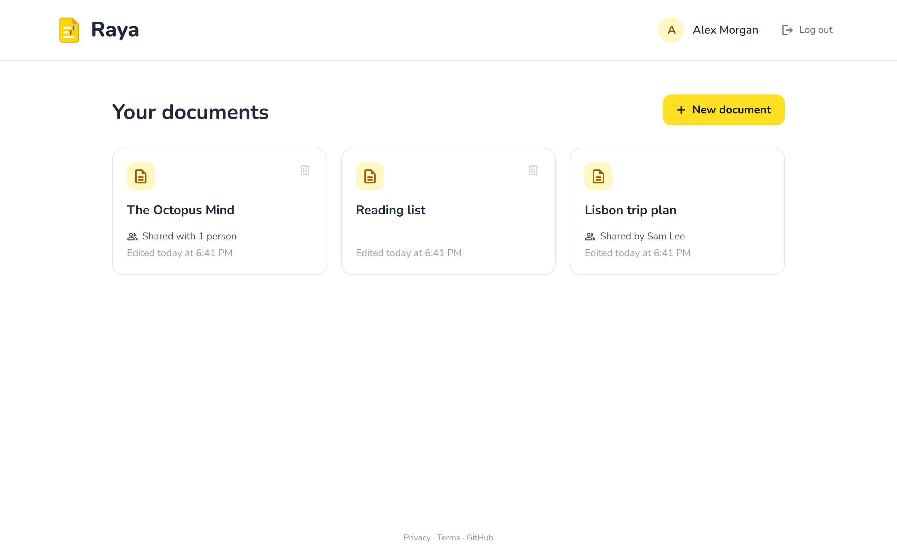
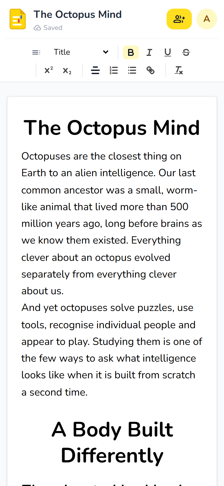

<p align="center">
  
</p>

<h1 align="center">Raya</h1>

<p align="center">
  A real-time collaborative document editor. Several people can edit the same document at once,
  and every change shows up on everyone's screen as it's typed.
</p>

<p align="center">
  SvelteKit · FastAPI · PostgreSQL · WebSockets · Quill · Docker
</p>

---

Raya is built from scratch, including the sync engine. It doesn't use a hosted service or a
collaboration library. The server keeps the document consistent with operational transformation (OT).
The browsers send their changes over WebSockets, and the server rebases each one on any edits
it hasn't seen yet. Every client ends up with exactly the same document.

It runs as a small personal service for a few people. Since it's open source, anyone can run their own
copy: see [SELF_HOSTING.md](SELF_HOSTING.md).

## Screenshots

**Editor**: the outline pane follows the cursor, and the text-style menu sets Title, Heading, Subtitle, Text or Tiny.



| Sign-in page | Documents | Editor on a phone |
|---|---|---|
|  |  |  |

## Features

**Real-time collaboration**
- Edits from everyone with the document open are merged live, and nothing is lost when people type in the same place at the same time.
- The editor shows the sync state: *Connecting*, *Saving*, *Saved*, *Offline*, or an error.
- A renamed document updates for everyone who has it open.
- Avatars in the header show who else has the document open right now, with their Google profile pictures.
- **Live cursors:** everyone sees each other's cursor and selection in that person's colour, with their name. Cursors stay on the right spot while anyone types, because each one is mapped through the same OT revisions as the text.

**Editing**
- Rich text: bold, italic, underline, strikethrough, superscript and subscript, alignment, lists, links.
- One-click text styles: *Title* (largest, bold, centred, one per document), *Heading* (bold, centred, for sections), *Subtitle* (bold italic), *Text* and *Tiny*. Pressing Enter after a heading switches back to Text.
- An **outline pane** lists every Title, Heading and Subtitle as three levels, jumps to a section on click and highlights the section the cursor is in.
- **Page breaks:** a toolbar button (or Ctrl+Enter) starts a new page, shown as a gap between pages. Downloads to Word keep them as real page breaks.
- **Download as Word (.docx)**, built in the browser. Title becomes Word's Title, and Headings and Subtitles become Word headings, so Word's navigation pane shows the same sections, and lists, links and formatting carry over. The converter only loads when it's first used.

**Sharing and accounts**
- Google Sign-In; Raya never sees a password.
- The owner shares a document by email and can remove people. Someone who loses access is disconnected straight away.
- Owners can delete documents, which also disconnects everyone editing them.
- Account tiers: new accounts are *guests*, with a limit on how many documents they can own and how long each can be. *Known* accounts have no limits. Both the browser and the server enforce the limits.

**Design**
- Works on phones as well as desktops: on small screens the toolbar wraps, the outline opens from a toolbar
  button, and a guest's character count moves to a corner of the page.
- A custom icon and visual identity.
- Privacy policy and terms of service pages.

## Architecture

```
Browser (SvelteKit app + Quill editor)
   │   HTTPS                          WebSocket /api/edit-socket/{doc}
   ▼                                          │
Caddy (HTTPS) ────────────────────────────────┤
   ├── /*      ──► SvelteKit server :3000     │   pages, sign-in, cookies,
   │                  │  signed bearer token   │   server-side API calls
   │                  ▼                        ▼
   └── /api/*  ──► FastAPI :8000 ◄─────────────┘   REST API + sync engine
                      │
                      ▼
                  PostgreSQL :5432                 users, documents, edit history
```

| Layer | Technology |
|---|---|
| Frontend | SvelteKit (Svelte 5 runes, Node adapter), Tailwind CSS v4, Quill 2 |
| Backend | FastAPI (Python 3.12, asyncio), asyncpg |
| Database | PostgreSQL 18 |
| Auth | Google Identity Services, JWTs (HS256, `jose`) |
| Infrastructure | Docker Compose, Caddy (reverse proxy, automatic HTTPS) |
| Testing | pytest, Node's built-in test runner (`node --test`) |

### Deployment

- One `docker compose` setup for development, plus `docker-compose.prod.yml` layered on top for production.
- Caddy serves the site over HTTPS and gets and renews its Let's Encrypt certificate itself. The same
  Caddyfile serves plain HTTP in development.
- Development and production have separate env files, with a separate Google OAuth client and separate secrets
  in each, as Google recommends.
- In production the database isn't reachable from outside, containers restart on failure, and logs are rotated.

See [SELF_HOSTING.md](SELF_HOSTING.md) for the steps.

### How syncing works

Each document is stored as a **head** (the full current document as a Quill delta, plus its revision number)
and a short **history** of recent changes.

1. When a browser opens a document, it gets the head and the revision number over the WebSocket.
2. The browser holds the document as three parts, `A ∘ X ∘ Y`:
   - `A` is the last server state it knows;
   - `X` is the one change sent to the server and not yet confirmed;
   - `Y` is the typing done since then.
   
   Only one change is in flight at a time. Incoming edits from others are transformed against `X` and `Y`,
   so the user's own unsent typing is never lost.
3. The server receives a change made against revision *n*. It transforms the change against every revision
   after *n*, in order, applies it to the head and saves the result as revision *n+1*. Then it confirms
   the change to the sender and broadcasts it to everyone else.
4. A history entry is deleted once every connected client has seen it, so the history stays small.

The server keeps its own Python implementation of Quill's delta algebra (`compose`, `transform`).
A test runs thousands of random operations through it and through the real `quill-delta` JavaScript
library, and requires identical results. Even a one-character difference would make documents drift apart.

### Concurrency and consistency

- **One lock per document** in the sync server. Joins, leaves and edits are serialized, so every client
  gets the initial document and then every later revision exactly once and in order.
- **Optimistic concurrency in Postgres.** Every document row has a `version` column, and writes go through
  a compare-and-swap (`UPDATE … WHERE version = $old`) with retries. Renames and sharing changes made
  outside the sync lock can't overwrite an edit.
- **Advisory locks** (`pg_advisory_xact_lock`) when creating a document, so two quick clicks can't get past
  the document limit.
- **Size limits checked on the server too.** Two people typing at once can go over the limit together even
  when each browser stops at it. The server turns down the change that would grow a document past its
  limit, and that browser reloads. A document that's already over the limit can still be shortened.

### Security

- The SvelteKit server checks the Google ID token, including its signature, audience and the CSRF
  double-submit cookie. It then sets a signed, `HttpOnly` session cookie. Every request verifies that cookie
  in a server hook.
- SvelteKit calls FastAPI with short-lived bearer tokens signed with a secret only the two servers share.
  The browser never holds a token that works on the API.
- To join the WebSocket, the browser gets a 60-second token that names a single document and has its own
  audience, so it can't be used as an API token or for a different document. The server checks access
  again when someone tries to join.
- Every endpoint checks ownership or collaborator access. Bad document IDs are rejected before any query runs.
- Secrets are read at runtime (`$env/dynamic`), never built into the JavaScript bundle or the Docker image.

## Testing

**Over 400 test cases** (78 test functions, many parametrized or randomized with fixed seeds) across the
backend and frontend. They run with `make test`.

| Suite | What it covers |
|---|---|
| `backend/tests/test_delta.py` | `compose` and `transform` cases, plus a randomized check that concurrent edits converge |
| `backend/tests/test_delta_vs_quill.py` | **Differential test:** 6,000 random operations run through the Python port and the real `quill-delta` (in Node), with identical results required |
| `backend/tests/test_doc_syncer.py` | The sync server against an in-memory fake database: revision numbering, rebasing concurrent edits, retries, history pruning, disconnecting removed collaborators, size limits, who has the document open, relaying cursors, and randomized multi-client sessions that must converge |
| `backend/tests/test_postgres_utils.py` | Database operations against real Postgres in a throwaway schema: sign-in and email edge cases, renames, sharing, compare-and-swap writes, limits, deletes |
| `backend/tests/test_auth.py` | API and WebSocket tokens: expiry, wrong audience, wrong document |
| `frontend/src/lib/sync_client.test.js` | The browser's sync state machine, including randomized sessions where every client's screen must match the server; mapping cursors between revisions and unsent edits |
| `frontend/src/lib/text_styles.test.js`, `outline.test.js` | Text-style detection and the outline/section tracking |
| `frontend/src/lib/export_docx.test.js` | Word export: generates real `.docx` files and checks the Word XML for headings, formats, links (only web links kept) and list numbering |

The sync logic in the browser has no Quill or DOM code, so Node can test it directly.

The UI was checked by hand in a real browser at phone, tablet and desktop sizes, with several users
editing at once.

## How it was built

I wrote the base of Raya myself: the first working version of the editor, the sync engine and its Python
delta implementation, the backend, the database and the Docker setup.
I then used [Claude Code](https://claude.com/claude-code) (Anthropic's AI coding assistant) for finding and
fixing bugs, writing the unit tests, designing the page layouts (including the mobile layout), and some
later features: the outline pane, the text-style menu, account limits, deleting documents, security
fixes and the legal pages.

## License

[MIT](LICENSE) © 2026 Rishi Kaley. You're free to use, change and run your own copy.

## Terms of service and privacy

The app serves a [privacy policy](frontend/src/routes/privacy/+page.svelte) at `/privacy` and
[terms of service](frontend/src/routes/terms/+page.svelte) at `/terms`, linked from the sign-in page.
In short:

- **Collected:**
  - from Google at sign-in: account ID, name, verified email and profile picture link;
  - the documents themselves, with who owns them and who they're shared with;
  - basic server logs.
- **Not done:** no ads, analytics or tracking, and data is never sold.
- **Cookies:** only the ones needed to sign in and stay signed in (7 days), plus Google's sign-in cookie.
- **Edit history:** individual edits are deleted automatically once every open copy of the document has them.
- **Deletion:** owners can delete documents at any time; deleting an account is done on request.
- **Ownership:** you own what you write. Raya is a personal project offered as-is, so keep your own copies
  of anything important.

## Learning points

### Real-time collaboration
- **OT needs every implementation to match exactly.** The server and browsers must compute identical
  transforms, including tie-breaking for inserts at the same position. Comparing the port against
  `quill-delta` on thousands of random inputs gives far more confidence than hand-written cases.
- **Each change must be rebuilt from the original on every retry.** When an optimistic write loses the race,
  the client's original change has to be transformed again from scratch. Reusing the already-transformed one
  gave wrong results.
- **One change in flight per client** makes the client state machine simple and easy to test. More
  concurrency there adds complexity for almost no gain at this scale.
- **History can be pruned safely** by tracking the last revision each client has seen. A client's
  revision has to be registered before the document is sent to it, or a race can delete history it still needs.
- **Limits have to be checked on the server.** Browser-side checks only cover one user, and concurrent edits
  from several users can add up past a limit.

### Web and auth
- A WebSocket can't send custom headers from the browser, so auth goes into the first message, as a
  short-lived token tied to one document.
- Signed cookies need checking on every request, not just at sign-in. Doing it once in a server hook
  avoids routes trusting the raw cookie.
- Google's `sub` is the stable account ID; an email can change or be reused, so it's only stored when verified.

### Frontend
- Quill's theme turns every `<select>` in its toolbar into its own picker. Rendering a custom dropdown only
  after Quill starts avoids that.
- A browser ignores choosing the option that's already selected. A hidden "Custom" state lets the user
  re-apply a style to a line whose formatting was changed by hand.
- `requestAnimationFrame` doesn't run in background tabs, so UI updated by remote edits there needs a timer.
- CSS `:has()` can style a line by its contents, for example the spacing around Titles, without extra markup.

### Docker
- `--env-file` on the `docker compose` command line only sets compose's interpolation context. It fills
  `${VAR}` inside docker-compose.yml and build `args:` listed without a value. It doesn't put anything into containers.
  - Without it, compose falls back to a `.env` file next to docker-compose.yml (none here), so `args:` end up empty.
  - To have a shell inside the container expand a variable instead of compose, escape it as `$${VAR}` (see the postgres healthcheck).
- A service's `env_file:` / `environment:` are runtime only. They're injected into the running container, never into the image build.
  - `environment:` lists each variable inline; `env_file:` loads them from a file.
- `args:` under `build:` are passed to the Dockerfile's `ARG`s.
  - During the build, ARGs are exposed as environment variables to `RUN` commands and their child processes (e.g. `npm run build` → `vite build`).
  - They aren't kept in the final image's environment; use `ENV` for that.
- SvelteKit's `$env/static/*` imports are inlined into the bundle at build time, so they need build args and end up in the image.
  `$env/dynamic/*` are read at runtime from the container environment, so `env_file:` works for those. This project uses dynamic.
  - `$env/dynamic/public` reaches the browser through the server-rendered page, so it isn't available on prerendered pages.
- `.dockerignore` excluding `.env*` means a `.env` file is never available inside the build.
- The Postgres service has no build step at all: it uses a pre-built image. `init.sql` in
  `/docker-entrypoint-initdb.d/` is run by the image's entrypoint at container startup, and only when
  the data volume is empty (first boot).
  - On first boot the entrypoint creates the database from `POSTGRES_USER`, `POSTGRES_PASSWORD` and
    `POSTGRES_DB` in the container's runtime environment (from `env_file:`), then runs `init.sql`.
  - On later boots it skips all of that and starts Postgres on the existing data. Changing those variables
    has no effect unless the volume is wiped. Schema changes since then go through a small migration that
    runs when the backend starts.
- Compose override files merge lists like `env_file:` and `ports:` instead of replacing them. A production
  override needs `!override` (replace the list) or `!reset` (clear it), or it would load the development
  env files too and keep the database port published.
- An `https` page can't open a `ws://` socket: browsers block it as mixed content. The socket URL has to
  follow the page's protocol (`wss://` on HTTPS).
